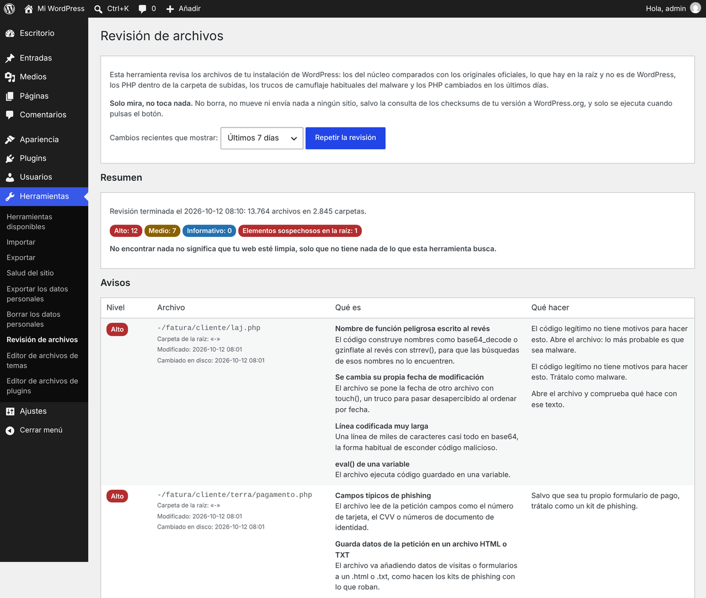
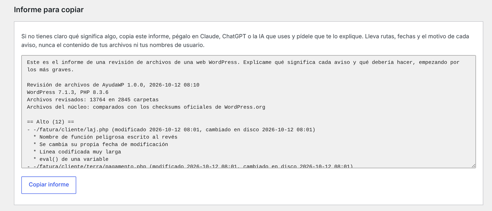

# AyudaWP File Review

Una revisión puntual y de solo lectura de los archivos de una web WordPress. Compara los archivos del núcleo con los checksums oficiales de tu versión, lista lo que hay en la raíz y no es de WordPress, busca PHP en la carpeta de subidas, rastrea los trucos de camuflaje que suelen repetirse en las webs hackeadas y te enseña qué PHP han cambiado hace poco. Cuando acabas, se borra a sí misma.

[Read in English](README.md)

Nació después de encontrar un kit de phishing y tres webshells que llevaban más de cinco años dentro de una web WordPress que estaba siempre actualizada. La historia completa está en [este artículo de Ayuda WordPress](ENLAZAR-POST), y cada comprobación de la herramienta sale de algo que apareció en ese caso.

*Las capturas están hechas en una instalación de pruebas con los archivos reales de aquel caso.*

## Qué revisa

| Comprobación | Qué busca | Nivel |
|---|---|---|
| Integridad del núcleo | Los archivos de la raíz, `wp-admin` y `wp-includes`, comparados con los checksums oficiales de tu versión y tu idioma (si tu idioma no los tiene, usa los de `en_US`). Archivos modificados, PHP que no son de WordPress y archivos que faltan | Alto para los modificados y los PHP de más, Medio para un `.htaccess` o `php.ini` de más, Informativo para el resto |
| Carpeta raíz | Todo lo que hay en la raíz y no es de WordPress, con el número de archivos PHP que hay dentro de cada carpeta desconocida | Las carpetas desconocidas con PHP y los PHP sueltos cuentan como sospechosos |
| Subidas | Cualquier PHP dentro de `wp-content/uploads` | Alto. Un `index.php` vacío y las plantillas Twig compiladas que guarda ahí WPML son Informativo |
| Camuflaje, por contenido | Nombres de funciones peligrosas escritos al revés con `strrev()`, archivos que se cambian su propia fecha con `touch()`, PHP que empieza con una cabecera de imagen, subidas que usan el nombre original del archivo, campos de formularios de phishing (número de tarjeta, CVV, CPF…) y líneas codificadas muy largas | Alto |
| Más comprobaciones de contenido | `eval()` de una variable, redirecciones a una dirección IP en lugar de a un dominio y datos de la petición que se van añadiendo a un `.html` o `.txt` | Medio |
| Configuración de PHP | `php.ini` o `.user.ini` que vacían `disable_functions`, desactivan el modo seguro o permiten incluir archivos remotos | Alto. `auto_prepend_file` es Medio, porque también lo usa el cortafuegos de Wordfence |
| `.htaccess` | Un filtro por país hecho a mano con muchas líneas `allow from` | Medio |
| Copias de `wp-config.php` | `wp-config.php.bak`, `wp-config-old.txt` y nombres parecidos. El servidor no las ejecuta como PHP y puede entregarlas como texto, contraseña de la base de datos incluida | Medio |
| Cambios recientes | PHP cambiados en las últimas 24 horas, 7 días o 30 días, agrupados por plugin, tema o carpeta. Usa el `ctime`, que no se puede falsificar desde PHP, y resalta los archivos que han cambiado hace poco pero muestran una fecha de modificación más de 30 días anterior | Lista |
| Administradores | Todos los administradores, con la fecha de alta de cada cuenta | Lista |

Las líneas codificadas merecen una explicación aparte. La herramienta decodifica la línea y mira con qué bytes empieza: las imágenes y fuentes incrustadas como data URI (iconos de menú, logos, fuentes de iconos) las ignora y los ajustes de ejemplo serializados los marca como Informativo. Todo lo demás lo avisa. Nada de lo que decodifica se ejecuta nunca.

## Qué no hace

- Solo lee. No cambia, no mueve ni borra tus archivos, y no envía nada a ningún sitio. La única petición de red es la que pide los checksums oficiales a api.wordpress.org.
- Solo se ejecuta cuando un administrador pulsa el botón. No hace nada en la parte pública, ni en segundo plano, ni con tareas programadas.
- Guarda los resultados en una sola opción, `ayudawp_fr_scan`, sin carga automática, que desaparece cuando borras la herramienta.
- No limpia nada, y no es un cortafuegos ni un escáner que vigile tu web de forma continua.

No encontrar nada no significa que tu web esté limpia, solo que no tiene nada de lo que esta herramienta busca.

## Instalación

Hay dos formas, y las dos acaban en el mismo sitio.

**Como cualquier otro plugin.** Descarga `ayudawp-file-review.zip` de la [última versión publicada](../../releases/latest), ve a *Plugins > Añadir plugin > Subir plugin*, elige el zip, instálalo y actívalo.

**Como mu-plugin.** Sube `ayudawp-file-review.php` a `wp-content/mu-plugins/` con el gestor de archivos o por SFTP (si la carpeta no existe, la creas). Los mu-plugins se cargan sin tener que activarlos.

Usa el zip de la página de versiones y no el botón *Download ZIP* de GitHub, que trae también los README y la carpeta de capturas, y esa carpeta se quedaría ahí cuando la herramienta se borre.

## Cómo se usa

1. Entra en *Herramientas > Revisión de archivos*.
2. Elige el periodo de los cambios recientes: últimas 24 horas, 7 días o 30 días.
3. Pulsa *Empezar la revisión*. Trabaja por tandas de pocos segundos, así que no se acerca al `max_execution_time` de ningún alojamiento. Una web con unos 60.000 archivos tardó en torno a medio minuto en nuestras pruebas.
4. Lee los resultados. Cada archivo sale una sola vez, con el nivel de su aviso más grave y con todos los motivos por los que se ha marcado, qué significan y qué hacer.
5. Si algo no lo tienes claro, pulsa *Copiar informe* y pégalo en Claude, ChatGPT o la IA que uses. Lleva rutas, fechas y el motivo de cada aviso, nunca el contenido de tus archivos ni tus nombres de usuario (los administradores salen como «Administrador 1», «Administrador 2»…).
6. Cuando acabes, marca *Sí, borrar los resultados y esta herramienta* y pulsa *Eliminar la herramienta de revisión*.

El botón de borrado elimina los resultados guardados y el archivo del plugin. Si lo instalaste como plugin normal, primero lo desactiva y después borra también su carpeta, junto con los README o la licencia que haya dentro. En webs con `DISALLOW_FILE_MODS` borra los resultados y te dice que borres el archivo a mano. Si lo borras desde la pantalla de *Plugins*, también se eliminan los resultados.

## Los tres niveles

- **Alto.** Algo que el código legítimo no tiene motivos para hacer. Trata el archivo como malware mientras no demuestres lo contrario.
- **Medio.** Algo que hacen unos pocos plugins legítimos: `eval()` en los plugins que ejecutan fragmentos de código, `auto_prepend_file` en algunos cortafuegos. Mira de qué plugin es el archivo antes de preocuparte.
- **Informativo.** Conviene saberlo, pero rara vez es un problema.

## Quién puede usarla

En un sitio normal, los administradores (`manage_options`). En una red multisitio, solo los superadministradores (`manage_network_options`), porque todos los sitios de la red comparten los mismos archivos. Cada acción comprueba la capacidad y un nonce.

## Cómo funciona por dentro

- Recorre la instalación con su propia lista de carpetas pendientes, que guarda entre tanda y tanda, y retoma exactamente donde se quedó la anterior. Si `wp-content` está fuera de la carpeta de WordPress, también la recorre.
- Cada tanda dura un tercio del `max_execution_time`, entre 2 y 10 segundos. Puedes cambiarlo con el filtro `ayudawp_fr_time_budget` (segundos, con decimales).
- No sigue enlaces simbólicos ni se salta ninguna carpeta por su nombre, porque un nombre en una lista de exclusiones es un buen sitio para esconderse.
- Lee archivos de hasta 2 MB. Los PHP más grandes y los que el servidor web no puede leer salen como Informativo, porque su contenido no se ha podido revisar.
- Los archivos del núcleo que coinciden con su checksum no pasan por las comprobaciones de contenido, porque ya se sabe que son los originales.
- Por qué el `ctime`: la fecha de modificación que ves en un listado (`mtime`) se cambia desde PHP con un simple `touch()`, y la shell del caso original lo hacía. La fecha de cambio (`ctime`) la pone el sistema y no se puede tocar desde PHP. Después de una migración o de restaurar una copia, casi todos los archivos tienen un `ctime` reciente y un `mtime` antiguo, así que cuando eso les pasa a más de 200 archivos la herramienta lo trata como una migración y solo lista los que están fuera de plugins y temas.
- Guarda como mucho 2.000 avisos, y la lista de archivos cambiados también tiene un tope, para que una web enorme no llene la base de datos.
- La interfaz está en inglés con la traducción al español incluida, para que siga siendo un solo archivo. Se puede traducir a otros idiomas con las herramientas de siempre (dominio de texto `ayudawp-file-review`).

## Con qué se ha probado

- Con los archivos reales del caso del que nació: salen todos.
- Con los 80 plugins más populares de WordPress.org y 20 de los temas más usados, más de 48.000 archivos PHP: ningún aviso Alto. Lo único que aparece son cuatro avisos Medio por `eval()`, en Code Snippets, WPCode, ManageWP Worker y un archivo de pruebas de Twig dentro de Elementor.
- Con una instalación real con WooCommerce, WPML, Elementor y Divi, de unos 60.000 archivos: ningún aviso Alto.
- Con PHP 8.3 y 8.5, y comprobación estática de compatibilidad hasta PHP 7.4. Pasa los WordPress Coding Standards y PHPCompatibilityWP, salvo la regla del nombre del archivo de la clase, que un plugin de un solo archivo no puede cumplir.

## Requisitos

- WordPress 5.5 o superior.
- PHP 7.4 o superior.

## Preguntas frecuentes

**¿Borra lo que encuentra?**
No. Te dice lo que ha encontrado y qué hacer, y la limpieza es cosa tuya. Los pasos están en esta [guía para limpiar un WordPress hackeado](https://ayudawp.com/limpiar-wordpress-hackeado-infectado/).

**¿Sustituye a un plugin de seguridad?**
No. Es una revisión que pasas una vez y borras. Si quieres algo que compare por su cuenta los archivos del núcleo con los originales y te avise por correo de lo que sobra, usa un plugin de seguridad como [Vigilante](https://es.wordpress.org/plugins/vigilante/), que fue el que detectó el caso original.

**El escáner de malware de mi alojamiento ha marcado el archivo.**
La herramienta contiene los patrones que busca: nombres de funciones peligrosas dentro de sus propias reglas. Los escáneres genéricos marcan a veces las herramientas de seguridad por eso. El código es un solo archivo legible, así que revísalo tú mismo, y borra la herramienta cuando termines.

**No se han podido descargar los checksums.**
Algunos servidores bloquean las peticiones salientes. El resto de comprobaciones se hacen igual, y el resumen avisa de que los archivos del núcleo no se han comparado.

**¿Es seguro pegar el informe en una IA?**
Para eso está pensado. Lleva rutas de archivos, fechas, avisos y tus versiones de WordPress y PHP. Ni el contenido de los archivos ni nombres de usuario.

## Avisar de problemas

Abre una [incidencia](../../issues) para fallos o falsos positivos. Si encuentras un problema de seguridad en la propia herramienta, no abras una incidencia pública: usa el [aviso privado de vulnerabilidades](../../security/advisories/new).

## Licencia

GPL-2.0 o posterior. El texto completo está en [LICENSE](LICENSE).

## Soporte

¿Necesitas ayuda o tienes sugerencias?

- [Web oficial](https://servicios.ayudawp.com)
- [Incidencias en GitHub](../../issues)
- [Canal de YouTube](https://www.youtube.com/AyudaWordPressES)
- [Documentación y tutoriales](https://ayudawp.com)

¿Te resulta útil? Dale una estrella al repositorio y ayúdanos a darlo a conocer.

## Sobre AyudaWP.com

Somos especialistas en plugins de seguridad, SEO, IA y optimización del rendimiento para WordPress. Creamos herramientas que resuelven problemas reales de los dueños de webs WordPress, manteniendo los estándares de código y los requisitos de accesibilidad más exigentes.
